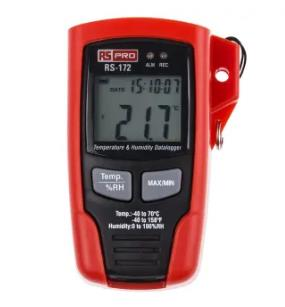

# rs172



A Python library and CLI for the **RS PRO RS-172** temperature/humidity data logger, built on the protocol reverse engineering of the [dl141th](https://sourceforge.net/projects/dl141th/) project (see [Credits](#credits)). The same hardware is sold as the CEM DT-172 and the Voltcraft DL-141TH. The package runs on Windows and Linux and covers every device function of the vendor's "RH And Temp Datalogger" software:

| Vendor software | Library | CLI |
|---|---|---|
| Correct Time | `dev.set_time()` | `rs172 set-time` |
| Datalogger Setup | `dev.setup(LoggerConfig(...))` | `rs172 setup ...` |
| Setup → Default | `dev.restore_defaults()` | `rs172 defaults` |
| Download Data (+ info/statistics) | `dev.download()`, `dev.read_info()` | `rs172 download`, `rs172 info` |
| Battery Power | `dev.battery()` | `rs172 battery` |
| Save | `to_csv()`, `to_json()` | `rs172 download -o file.csv\|.json` |

Printing and the vendor's `.record`/`.xls` files are out of scope. A simple plot of exported files is available as an optional extra (see [Plotting](#plotting)).

## Install

Requires Python ≥ 3.10.

```
pip install rs172
pip install "rs172[plot]"   # also installs matplotlib for the plot command
```

For development, clone the repository and run `pip install -e ".[dev]"`.

* **Windows:** install the Silicon Labs CP210x driver. The vendor installer includes it. The logger then appears as a COM port. The vendor software must be closed, because it keeps the port open.
* **Linux:** the `cp210x` driver is part of the kernel, and the logger appears as `/dev/ttyUSB0`. Your user needs access to the port, either by joining the `dialout` group (`sudo usermod -aG dialout $USER`, then log in again) or through a udev rule:
  ```
  SUBSYSTEM=="tty", ATTRS{idVendor}=="10c4", ATTRS{idProduct}=="ea60", MODE="0666"
  ```

## Important device behaviour

* **Setup and setting the clock erase the stored data** and start a new log. Download first. `rs172 setup --download-first backup.csv` does both in one step.
* **Reading the header or downloading stops a running log.** Run setup again to start a new one. `rs172 info` and `rs172 download` therefore ask for confirmation (skip with `-y`). Setting the clock also ends the running log and erases it, so `rs172 set-time` asks first too. Querying the battery does not interrupt logging (checked during a running log).
* The logger stores at most 16350 samples. Readings are always stored in °C; the °C/°F choice only applies to the alarm thresholds.

## CLI

The port is autodetected from the USB ID of the logger's bridge chip (CP210x, `10C4:EA60`); nothing is sent to any port for this. Other devices use the same chip, so if there are several such ports, the command stops with an error instead of guessing. To choose the port yourself, use `-p COM3` / `-p /dev/ttyUSB0` or set `RS172_PORT`. `rs172 ports --probe` sends each port the battery query (which does not interrupt logging) to show where an RS-172 answers.

```
rs172 ports [--probe]             # list CP210x ports; --probe checks which one answers
rs172 battery
rs172 info                        # header: start, rate, sample count, alarms (stops logging; asks first)
rs172 download -y -o data.csv     # or data.json; without -o CSV goes to stdout; -y skips the question
rs172 set-time [--time "2026-11-24 10:00:00"]
rs172 setup -i 5 -u min --start auto --led off --temp-low -10 --temp-high 30 --rh-low 20 --rh-high 80
rs172 setup --interactive           # asks for each setting, shows a summary and the equivalent command, confirms
rs172 defaults
rs172 -vv battery                 # show raw serial traffic
```

Run `rs172 <command> --help` for all options. Commands that erase data ask for confirmation unless you pass `-y`.

## Library

```python
from datetime import timedelta
from rs172 import RS172, LoggerConfig, Interval, IntervalUnit, LedCycle, StartMode, to_csv

with RS172.open() as dev:                       # or RS172.open("COM3")
    print(dev.battery())                         # 70%-100%

    log = dev.download()                         # LogData
    print(log.start, log.end, len(log))
    print(log.temperature_stats().max)           # Extreme(value=24.0, time=...)
    for r in log.readings:
        print(r.time, r.temperature_c, r.temperature_f, r.humidity)
    to_csv(log, "backup.csv")

    dev.setup(LoggerConfig(
        interval=Interval.from_timedelta(timedelta(minutes=5)),
        led_cycle=LedCycle.OFF,
        start_mode=StartMode.AUTOMATIC,
        temp_alarm_low=-10, temp_alarm_high=30,
    ))
```

`LoggerConfig.default()` returns the vendor's factory defaults. `config.record_duration` is the vendor's "Rec Time": how long until memory is full.

## Plotting

With the `plot` extra installed (`pip install "rs172[plot]"`), `rs172 plot` draws a CSV or JSON file written by `rs172 download`. Temperature and humidity are shown in two panels that share the time axis. The y axes span at least 4 °C (7.2 °F) and 5 %RH, so sensor noise does not look like big swings.

```
rs172 plot data.csv                  # opens a window
rs172 plot data.json -o data.png     # saves the plot instead (.png, .pdf, .svg, ...)
rs172 plot data.json --alarms --fahrenheit --title "Server room"
```

`--alarms` draws the alarm thresholds, which only JSON exports contain. In Python, use `rs172.plot.load(path)` and `rs172.plot.plot(series)`; the second returns a matplotlib `Figure`.

## Protocol

[docs/protocol.md](https://github.com/jonas-hagen/RS-172_tool/blob/main/docs/protocol.md) describes the protocol. It builds on the reverse engineering in Helmut Schmidt's [dl141th](https://sourceforge.net/projects/dl141th/) (MIT), and all of it was re-verified against an RS-172 and the vendor software.

Not verified yet: data readout after a **circular-logging wraparound**, which needs 16350 samples (≥ 4.5 h at 1 s). Until then, a wrapped circular log is downloaded in memory order.

## Tests

```
pytest
```

The tests use captured device frames and a byte-level fake logger, so no hardware is needed.

## Credits

* **Protocol reverse engineering:** Helmut Schmidt worked out the serial protocol of the Voltcraft DL-141TH, the same hardware, in [dl141th](https://sourceforge.net/projects/dl141th/) (MIT). This package builds on that work. Every command was re-verified against an RS-172 and the vendor software, and the remaining details were filled in.
* **Development:** the library, CLI, tests and documentation were written with the help of Claude Code.

## License

MIT, see [LICENSE](https://github.com/jonas-hagen/RS-172_tool/blob/main/LICENSE). The product photo is taken from the RS Components datasheet for RS stock no. 146-9091. The protocol knowledge builds on [dl141th](https://sourceforge.net/projects/dl141th/) by Helmut Schmidt, also MIT-licensed.
